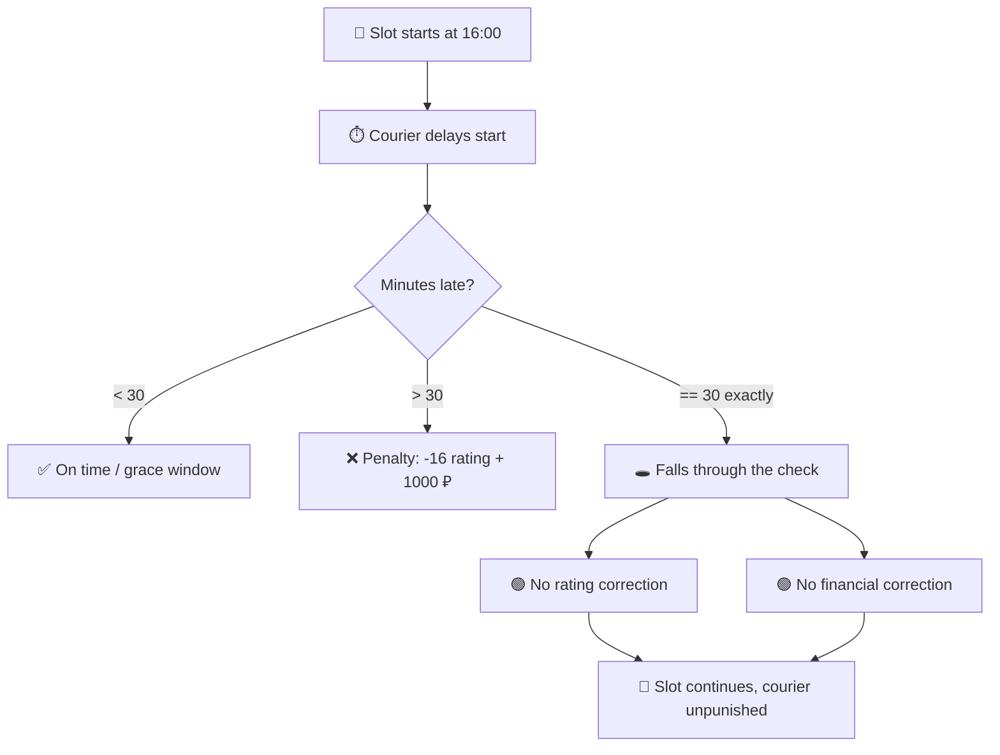

# 🛡️ Bug Bounty Research `#008`

### Yandex Lavka — Courier Penalty Bypass (Business Logic)

*Hit the 30-minute mark exactly and the late penalty never fires*

 

 

[📌 Info](#-report-information) •
[🔍 Summary](#-summary) •
[🧪 Findings](#-findings) •
[⚠️ Impact](#️-security-impact) •
[🛠️ Fix](#️-recommended-remediation) •
[📊 Outcome](#-report-outcome)

---

## 📌 Report Information

<table>
<tr>
<td>

| Field | Details |
|:---|:---|
| 🎯 **Target** | Yandex Lavka / Yandex Pro |
| 🏢 **Program** | Yandex Lavka |
| 🏟️ **Platform** | Yandex BugBounty |
| 👤 **Researcher** | `sqlqwero` |
| 🪪 **Submitted as** | `trp` |
| 📅 **Date** | January 15, 2026 |

</td>
<td>

| Field | Details |
|:---|:---|
| 🐞 **Type** | Business Logic / Penalty Bypass |
| 🌡️ **Severity** | 🔴 High |
| 🏷️ **CWE** | [CWE-840](https://cwe.mitre.org/data/definitions/840.html) |
| 🔗 **Related** | [CWE-841](https://cwe.mitre.org/data/definitions/841.html) · Off-by-one |
| 📤 **Status** | ✅ Accepted & Rewarded |
| 💰 **Bounty** | **50 000 ₽** |

</td>
</tr>
</table>

---

## 🔍 Summary

> [!NOTE]
> A business-logic flaw in the courier slot workflow let a late courier avoid every late-arrival penalty by starting the slot at the exact boundary value.

When a courier is late, the platform applies two penalties:

- 📉 **−16 rating points**
- 💸 **1000 ₽ financial correction**

But the lateness threshold is checked with a flawed boundary condition. Starting the slot at **exactly 30:00 late** falls into neither "on time" nor "penalized" — the courier keeps the slot with **no rating hit and no fine**.

---

## 🧪 Findings

| # | Finding | Behavior | Risk |
|:---:|:---|:---|:---:|
| 1 | Late penalty skipped at the exact threshold | `start == +30:00` → no penalty | 🔴 |
| 2 | Rating correction bypassed | −16 points never applied | 🔴 |
| 3 | Financial correction bypassed | 1000 ₽ fine never charged | 🔴 |
| 4 | Slot continues normally | No downstream flag raised | 🟠 |
| 5 | Repeatable every slot, by any courier | Systemic abuse | 🔴 |

🔴 High &nbsp;•&nbsp; 🟠 Medium

> [!CAUTION]
> This is a logic flaw, not a technical exploit — no injection, no auth bypass, just a mishandled boundary in the penalty rule.

### 🧭 Logic Flow

<b>🔬 Methodology</b>

 

1. Review of the courier slot lifecycle and the late-arrival penalty rule
2. Observation of penalty behavior just below, at, and just above the 30-minute mark
3. Isolation of the exact boundary (`16:30:00`) where neither branch of the rule fires
4. Confirmation that both the rating and financial corrections are skipped

Tested on the researcher's own courier account only. No other accounts or real orders were affected.

---

## ⚠️ Security Impact

> [!WARNING]
> A courier can systematically dodge late-arrival penalties, which has direct financial and operational impact.

- 💸 **Revenue leakage** — the 1000 ₽ correction is never collected from offenders
- 📉 **Rating integrity broken** — the −16 penalty that protects service quality is bypassed
- 🔁 **Scalable abuse** — any courier can repeat this on every slot, intentionally arriving ~30 min late
- 🚚 **Operational harm** — reliable late starts degrade delivery SLAs with no accountability

> [!IMPORTANT]
> The flaw sits entirely in server-side business logic. No customer or courier personal data was accessed.

---

## 🛠️ Recommended Remediation

- [ ] Fix the boundary condition so the exact threshold is covered by one branch (use `>=` consistently)
- [ ] Add a unit test for the `== 30:00` edge case specifically
- [ ] Audit the whole slot-penalty rule for other off-by-one gaps (start, end, grace windows)
- [ ] Reconcile historical slots for starts at the exact threshold and correct missed penalties
- [ ] Add server-side monitoring for slots started suspiciously close to the penalty boundary

---

## 📊 Report Outcome

| Metric | Result |
|:---|:---:|
| 📤 Submission | ✅ Submitted |
| ⚖️ Platform Decision | ✅ Accepted |
| ✔️ Accepted | ✅ Yes |
| 💰 Reward | **50 000 ₽** |
| 🏦 Payment Received | ✅ Paid |

### 🕒 Timeline

| Date | Event |
|:---|:---|
| 2026-01-15 | 🔎 Vulnerability identified |
| 2026-01-15 | 📤 Report submitted to Yandex BugBounty |
| — | ✅ Triaged & accepted |
| — | 💰 Rewarded 50 000 ₽ |
| — | 🏆 Added to Hall of Fame |

---

## 🔗 References

- 🏆 [Yandex BugBounty — Hall of Fame](https://yandex.ru/bugbounty/)
- 🏷️ [CWE-840: Business Logic Errors](https://cwe.mitre.org/data/definitions/840.html)
- 🏷️ [CWE-841: Improper Enforcement of Behavioral Workflow](https://cwe.mitre.org/data/definitions/841.html)
- 📘 [OWASP — Testing for Business Logic](https://owasp.org/www-project-web-security-testing-guide/)

---

**🛡️ Independent Security Research Portfolio**

*All testing is conducted within authorized program scopes.*

Research #008 • Yandex BugBounty • 2026 • by sqlqwero (trp)

